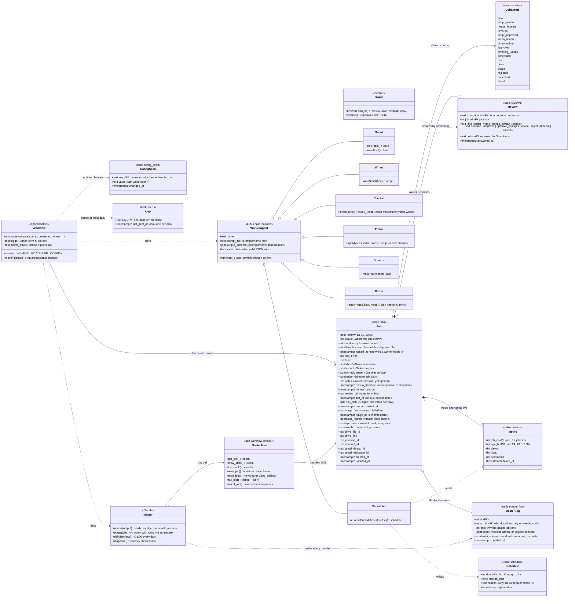

# ShortCircuit

An n8n AI crew that runs a tech YouTube Shorts channel: it researches a topic, writes and
fact-checks a script, renders a vertical video and publishes one Short a day.

The real goal is to **learn n8n multi-AI orchestration**. Native n8n nodes come first
(AI Agent, LLM chains, Guardrails, Send-and-Wait, Forms, Evaluations); code only where no
node fits. Full design: [`docs/PLAN.md`](docs/PLAN.md).

- Seven worker agents on local (Ollama) or free-tier models (Gemini, Groq), with fallback chains.
- A Master agent (Claude, via n8n's Anthropic Chat Model node) reviews and triages.
- The owner reviews through n8n forms mailed by Gmail, reachable only over Tailscale.
  Silence approves; a buffer of 3+ scheduled videos keeps the daily slot safe.

## Status

Milestone **M0** (infra) in progress. Done so far: Docker Compose stack, Postgres schema,
`.env` apply script with launchd agent and tests. Workflows, renderer and prompts come in
M1–M9 (PLAN §14).

## Layout

| Path | What |
|---|---|
| `docker-compose.yml` | Postgres 16, n8n, Kokoro TTS (renderer added at M4) |
| `db/init.sql` | Databases, roles and tables (PLAN §9) |
| `.env.example`, `renderer.env.example` | Settings templates; copy to `.env` / `renderer.env` |
| `scripts/apply-env.sh` | Validates `.env`, writes `state/.env.live`, recreates n8n safely |
| `launchd/com.shortcircuit.apply-env.plist` | Runs `apply-env.sh` on each `.env` save and every 60 s |
| `tests/apply-env.test.sh` | Tests for `apply-env.sh` with stub docker/osascript |
| `docs/PLAN.md` | The full plan and milestones |

`state/`, `data/`, `.env` and `renderer.env` are git-ignored. `state/` is host-only and never mounted.

## Class diagram

There is no class code yet: n8n workflows do the work. This diagram shows the main *things*
in the system, what each one holds, and how they connect. Tables come from `db/init.sql`;
agents and workflows come from PLAN §4 and §10.5.



How to read it:
- **Box** = one thing. `<<table x>>` boxes are real Postgres tables; the rest are roles played by n8n workflows.
- **`+field type «note»`** = a column or property, its type, and what it means.
- **Hollow triangle arrow** = "is a kind of": every worker agent shares the same shape.
- **Filled diamond** = "owns": the row belongs to one job. **Hollow diamond** = "links to", may be empty.
- **Solid arrow** = "points to or changes". **Dashed arrow** = "uses".
- **`"1" … "0..*"`** = how many: one job has zero or more reviews.

## Setup (macOS)

```sh
cp .env.example .env              # fill in; secrets: openssl rand -hex 32 / 24
cp renderer.env.example renderer.env
bash scripts/apply-env.sh         # writes state/.env.live
docker compose up -d

# auto-apply future .env saves
sed "s|__ROOT__|$PWD|g" launchd/com.shortcircuit.apply-env.plist \
  > ~/Library/LaunchAgents/com.shortcircuit.apply-env.plist
launchctl bootstrap gui/$(id -u) ~/Library/LaunchAgents/com.shortcircuit.apply-env.plist
```

n8n listens on `127.0.0.1:5678` only; expose it to your tailnet with `tailscale serve`
(never `funnel`). `N8N_ENCRYPTION_KEY` and the Postgres passwords cannot be changed by a
reload; back up the key.

## Tests

```sh
bash tests/apply-env.test.sh
```
